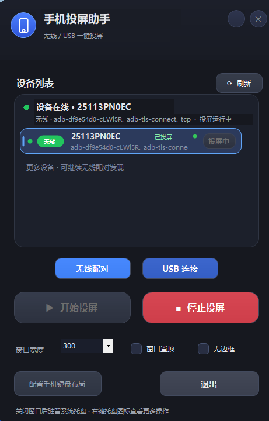
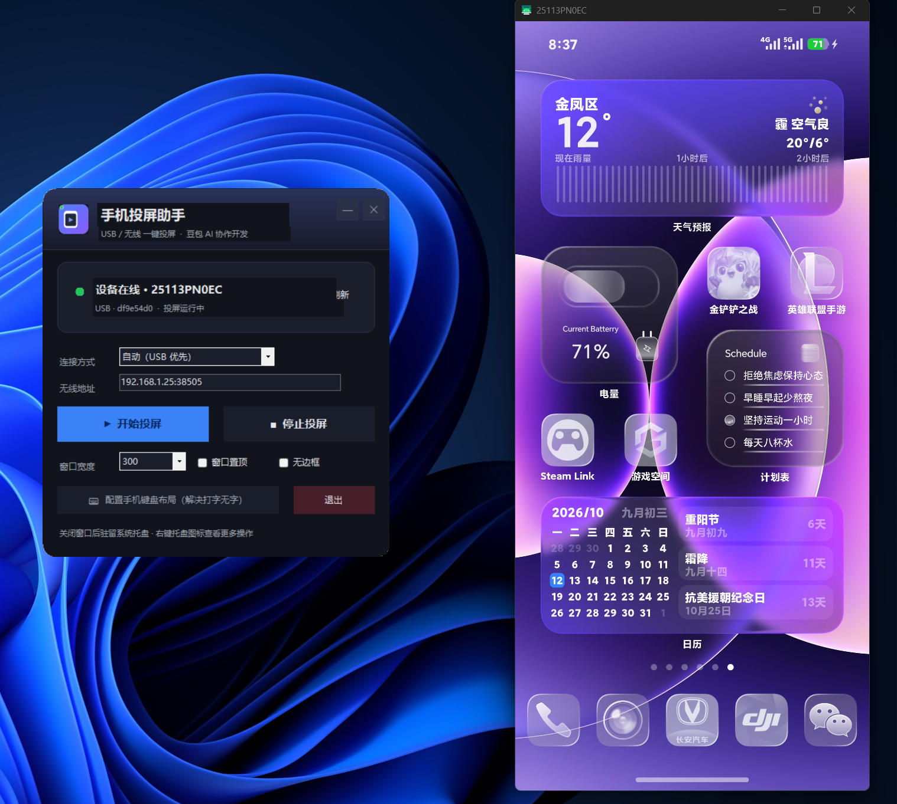

# Phone Mirror Assistant · 手机投屏助手

[](LICENSE)
[]()
[]()
[](https://github.com/Genymobile/scrcpy)

A USB-first, phone screen mirroring tool for Windows, powered by [scrcpy](https://github.com/Genymobile/scrcpy).
基于 scrcpy 的 Windows 手机投屏工具：**插上数据线自动识别并投屏**，无线调试作为备用方案；自带深色主界面与系统托盘，无需在手机上安装任何应用。

> 本项目由 **@cfq123451** 发起，**豆包（Doubao）AI 助手参与设计、开发与文档编写**。

## ✨ Features

- **USB-first auto-connect** —— 数据线插上并授权后自动识别设备、自动投屏；无线调试可作为回退（连接方式：`自动 / 仅 USB / 仅无线`）
- **Main window UI** —— 启动即显示深色圆角主界面：设备状态卡片、连接方式、窗口参数、一键开始/停止
- **System tray** —— 关闭窗口驻留托盘，右键菜单可快速操作；单实例保护
- **Reverse control** —— 鼠标/键盘反控手机，中文输入可用（`--keyboard=uhid`，支持手机 IME）
- **No phone app required** —— 手机只需开启「USB 调试」/「无线调试」
- **Portable** —— 绿色单目录，双击即用，无需安装

## 📸 Screenshots

| 主界面 Main Window | 
| --- | --- |
|  | |  |

## 🚀 Quick Start

1. 下载最新 [Release](https://github.com/cfq123451/phone-mirror-assistant/releases) 的 `手机投屏助手-vX.Y.Z.zip`，解压（已内置 scrcpy 运行时）
2. 手机：设置 → 关于手机 → 连点「版本号」7 次开启开发者模式 → 打开「USB 调试」或 「无线调试」
3. 数据线连接电脑（机箱后置 USB 口），手机上点「允许 USB 调试」
4. 通过无线调试配对电脑，CMD窗口输入adb pair IP地址:端口号  ，然后回车输入6位配对码
   
5. 双击 `手机投屏.exe` —— 自动识别设备并开始投屏

> 注意：电脑连手机热点时多数机型会拒绝「无线调试」，此时 USB 是最稳的方案。

## 🔨 Build from source

**Requirements:** Windows 10/11 · .NET Framework 4.0+（系统自带）· PowerShell 5+

```powershell
# 可选：重新生成图标（assets/手机投屏.ico）
.\scripts\make-icon.ps1

# 编译并组装出可运行的 dist\（若缺 scrcpy 会自动下载）
.\scripts\build.ps1
```

产物 `dist\` 目录可直接运行。GitHub Actions 会在每次推送/打标签时自动构建并上传 `dist` 产物。

## 📖 Usage

- **开始/停止投屏**：主界面一键控制；启动时若检测到设备会自动投屏（`auto_start`）
- **窗口参数**：宽度 300~1200、置顶、无边框
- **连接方式**：
  - `自动（USB 优先）`：优先 USB 设备，没有则回退无线地址
  - `仅 USB` / `仅无线`：强制走某一通道（无线需在「无线地址」填 `IP:端口`）
- **托盘**：关闭窗口 = 驻留托盘；右键托盘 → 显示主界面 / 开始 / 停止 / 配置手机键盘布局 / 退出
- **反向打字不出字**：点「配置手机键盘布局」→ 手机端首次选择 `English(US)`，之后中文输入正常

## ⚙️ Configuration (`config.ini`)

见 [config.example.ini](config.example.ini)：`mode`(auto/usb/wifi)、`conn_addr`、`window_width`、`always_on_top`、`borderless`、`auto_start`。程序退出时自动写回。

## 🛠 Troubleshooting

| 问题 | 处理 |
| --- | --- |
| 识别不到设备 | 换一根能传数据的线；USB 模式选「传输文件/MTP」；设备管理器有黄色感叹号用「驱动总裁」/厂商驱动装 `Android ADB Interface` |
| 无线调试连不上 | 电脑连手机热点时多数手机拒绝无线调试 → 改用 USB |
| 杀毒软件提示 | 程序未签名，首次运行点「允许/信任」即可 |
| 投屏中途退出 | 确认手机端弹窗已点「始终允许」，再点「停止投屏」后重新「开始投屏」 |

## 📄 License

[Apache-2.0](LICENSE)。第三方组件与许可见 [THIRD_PARTY_NOTICES.md](THIRD_PARTY_NOTICES.md)。

## 🙏 Credits

- **发起 & 开发者**：[@cfq123451](https://github.com/cfq123451)
- **协作开发 / 文档 / 设计**：豆包（Doubao）AI 助手
- **核心投屏引擎**：[scrcpy](https://github.com/Genymobile/scrcpy) (Apache-2.0)
