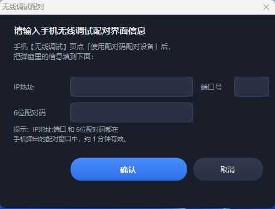

# Phone Mirror Assistant · 手机投屏助手

**🌐 Language:** [**English**](README.md) · [**中文**](README.zh.md)

[](LICENSE)
[-blue)]()
[]()
[](https://github.com/Genymobile/scrcpy)

One-click phone screen mirroring for **Windows, macOS & Linux**, powered by [scrcpy](https://github.com/Genymobile/scrcpy). Plug in a USB cable or pair wirelessly — the app auto-detects your phone and mirrors it with audio and reverse control. **No app needs to be installed on your phone.**

> This project is initiated by **@cfq123451**

## ✨ Features

- **USB / wireless auto-detect** — Dynamic device list with connection-type badges (USB / Wi-Fi); the same phone shown via both connections is deduplicated automatically
- **Wireless pairing wizard** — Enter the IP / port / 6-digit pairing code shown on your phone; `adb pair` runs automatically in the background
- **USB connection wizard** — Detects your USB device and asks for confirmation; shows three troubleshooting hints when no cable is detected
- **One-click mirroring** — Start / stop from the main window or the tray; each device row has its own "Mirror" button, multiple devices can mirror at the same time
- **Audio + reverse control** — Sound and screen output together; control your phone with mouse & keyboard, Chinese input works (`--keyboard=uhid`)
- **System tray** — Closing the window keeps the app in the tray with a right-click quick menu
- **Same experience on Windows, macOS and Linux** — A graphical UI on all three platforms; install like any normal app
- **No phone app required** — Just enable "USB debugging" / "Wireless debugging" on the phone

> Note: The macOS app mirrors **Android** phones. To mirror an **iPhone**, use the built-in macOS features instead: AirPlay (wireless) or QuickTime Player (wired) — no extra software needed.

## 📸 Screenshots

| Main Window | Wireless Pair |
| --- | --- |
|  |  |

## 📦 Downloads (v2.2.2)

All installers live in **one** [Release](https://github.com/cfq123451/phone-mirror-assistant/releases). Pick the one for your platform:

| Platform | Package | Install |
| --- | --- | --- |
| Windows 10/11 (64-bit) | `phone-mirror-assistant-windows-64-v2.2.2.exe` | Run the Setup program; desktop & Start-menu shortcuts are created automatically |
| macOS (Apple Silicon / M-series) | `phone-mirror-assistant-macos-arm64-v2.2.2.dmg` | Open the .dmg and drag the app to Applications |
| macOS (Intel) | `phone-mirror-assistant-macos-x86_64-v2.2.2.dmg` | Open the .dmg and drag the app to Applications |
| Debian / Ubuntu / Raspberry Pi OS (x86_64) | `phone-mirror-assistant_2.2.2-1_amd64.deb` | `sudo apt install -y ./phone-mirror-assistant_2.2.2-1_amd64.deb` |
| Debian / Ubuntu / Raspberry Pi OS (ARM64) | `phone-mirror-assistant_2.2.2-1_arm64.deb` | `sudo apt install -y ./phone-mirror-assistant_2.2.2-1_arm64.deb` |

The .deb packages pull in their dependencies automatically (`python3-pyside6`, `adb`, `scrcpy`). On macOS, install the engine once with `brew install scrcpy android-platform-tools` — the app then launches like any normal app, no terminal needed. After installing, launch **Phone Mirror Assistant** from your app menu.

## 🚀 Quick Start

1. Download and install the package for your platform from the [Releases](https://github.com/cfq123451/phone-mirror-assistant/releases) page (scrcpy runtime is bundled with the Windows installer; on Linux it is installed automatically as a dependency)
2. On your phone: Settings → About phone → tap "Build number" 7 times to enable Developer Mode → turn on "USB debugging" or "Wireless debugging"
3. **USB mirroring:** Connect the phone to the PC with a data cable (use a rear USB port on desktops), tap "Allow USB debugging" on the phone, then click **USB 连接** in the main window to auto-detect and mirror
4. **Wireless mirroring:** On the phone open "Wireless debugging" → "Pair device with pairing code", click **无线配对** in the main window, enter the IP / port / 6-digit code shown on the phone, confirm — pairing and mirroring happen automatically

> Note: When the PC is connected to the phone's hotspot, most phones refuse "Wireless debugging" — USB is the most reliable option in that case.

## 📖 Usage

- **Start / stop mirroring** — One-click control from the main window; auto-mirrors when a device is detected at startup (`auto_start`)
- **Window options** — width 300–1440, always-on-top, borderless
- **Device list** — auto-detects USB & wireless devices (connection-type badges), deduplicates the same phone shown via both connections; each row has its own "Mirror" button
- **Wireless pairing** — click **无线配对** → enter the IP / port / 6-digit code from the phone dialog → `adb pair` runs in the background, success/failure is reported in a popup
- **USB connection** — click **USB 连接** → detects the USB device and asks "Connected to XXX. Start mirroring?"; shows three troubleshooting hints when no cable is detected
- **Tray** — closing the window keeps the app in the tray; right-click the tray icon → show main window / start / stop / wireless pair / exit
- **Chinese typing not working** — click **配置手机键盘布局** → on the phone select `English(US)` the first time, then Chinese input works

## 🔨 Build from source

### Windows

**Requirements:** Windows 10/11 · .NET Framework 4.0+ (built-in) · PowerShell 5+

```powershell
# Optional: regenerate the icon (assets/手机投屏.ico)
.\scripts\make-icon.ps1

# Compile and assemble a runnable dist\ (auto-downloads scrcpy if missing)
.\scripts\build.ps1
```

The resulting `dist\` folder is directly runnable. The installer (`phone-mirror-assistant-windows-64-*.exe`) is built with Inno Setup from `phone-mirror-assistant.iss`.

### Linux / macOS (GUI, PySide6)

Source: [`linux-gui/`](linux-gui/) — a full graphical app (device list, pairing dialog, USB wizard, tray, config file at `~/.config/phone-mirror-assistant/config.ini`, or `~/Library/Application Support/phone-mirror-assistant/config.ini` on macOS).

```bash
# Build both .deb packages locally (Linux)
cd linux-gui
bash build_deb.sh all        # outputs dist/phone-mirror-assistant_2.2.2-1_{amd64,arm64}.deb
```

GitHub Actions (`build-linux-gui.yml`, `build-macos.yml`) builds and uploads the Linux and macOS packages automatically on every tag.

## ⚙️ Configuration

Windows: `config.ini` next to the executable. Linux: `~/.config/phone-mirror-assistant/config.ini`. macOS: `~/Library/Application Support/phone-mirror-assistant/config.ini`.

See [config.example.ini](config.example.ini): `mode`(auto/usb/wifi), `conn_addr`, `window_width`, `always_on_top`, `borderless`, `auto_start`.

## 🛠 Troubleshooting

| Issue | Fix |
| --- | --- |
| Device not detected | Try a cable that supports data transfer; set USB mode to "File Transfer/MTP"; if Device Manager shows a yellow exclamation mark, install the `Android ADB Interface` driver (vendor driver or "Driver Booster") |
| Wireless debugging fails | If the PC is on the phone's hotspot, most phones refuse wireless debugging → use USB instead |
| Antivirus warning | The program is unsigned — click "Allow/Trust" on first run |
| Mirroring exits mid-session | Make sure you tapped "Always allow" on the phone dialog, then click "Stop" and "Start" again |
| Linux: buttons not found | Verify the app menu entry "Phone Mirror Assistant" exists after install, or run `phone-mirror-assistant` in a terminal to see errors |

## 📄 License

[Apache-2.0](LICENSE). Third-party components and licenses: [THIRD_PARTY_NOTICES.md](THIRD_PARTY_NOTICES.md).

## 🙏 Credits

- **Initiator & developer:** [@cfq123451](https://github.com/cfq123451)
- **Co-development / docs / design:** Doubao AI assistant
- **Core mirroring engine:** [scrcpy](https://github.com/Genymobile/scrcpy) (Apache-2.0)
